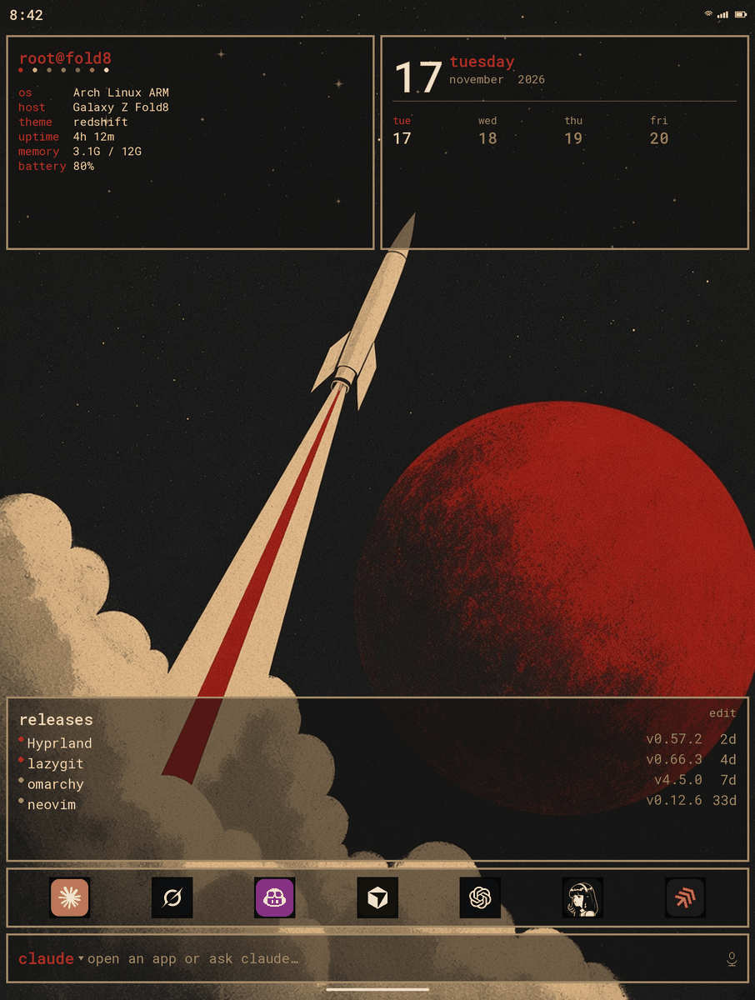

# redshift

a grainy 1960s launch poster at midnight: cream type on a star field, crimson accent



## Palette

| Key | Value |
|-----|-------|
| `mode` | `dark` |
| `accent` | `#c43a2c` |
| `selection` | `#321a15` |
| `muted` | `#a38a68` |
| `background` | `#121110` |
| `dark_background` | `#0c0b0b` |
| `darker_background` | `#080707` |
| `lighter_background` | `#1e1c1b` |
| `foreground` | `#ead6b3` |
| `dark_foreground` | `#a38053` |
| `light_foreground` | `#f0e0c4` |
| `bright_foreground` | `#f6ecd8` |

Full `colors.toml`:

```toml
mode = "dark"

accent = "#c43a2c"
selection = "#321a15"
muted = "#a38a68"

background = "#121110"
dark_background = "#0c0b0b"
darker_background = "#080707"
lighter_background = "#1e1c1b"

foreground = "#ead6b3"
dark_foreground = "#a38053"
light_foreground = "#f0e0c4"
bright_foreground = "#f6ecd8"

red = "#b4281c"
yellow = "#d3ac77"
orange = "#c06838"
green = "#7a844c"
cyan = "#6a8a82"
blue = "#5a6e86"
magenta = "#a34d58"
brown = "#8b6b46"

bright_red = "#e05542"
bright_yellow = "#efd0a0"
bright_green = "#9aa85e"
bright_cyan = "#8eb0a8"
bright_blue = "#7a8eaa"
bright_magenta = "#c46a74"
```

## Install

Paste this URL into Omalauncher's theme install:

https://github.com/TheFifeDawg/omarchy-redshift-theme

On an Omarchy laptop: **Install > Style > Theme**, paste the same URL.

## Credits

The three wallpapers are original AI-generated screenprints made for this theme. The palette and style were inspired by a retro space-race poster Michael shared.

Wallpapers are composed at 1848×2448 for the Samsung Galaxy Z Fold 8 inner screen. Omalauncher uses a single image and center-crops it to the cover screen (1248×1972), so each wallpaper is framed to hold up on both.

This repo also includes a `btop.theme` generated from Omarchy's official template, so the palette applies on a laptop as well.

## License

MIT. See [LICENSE](LICENSE).
